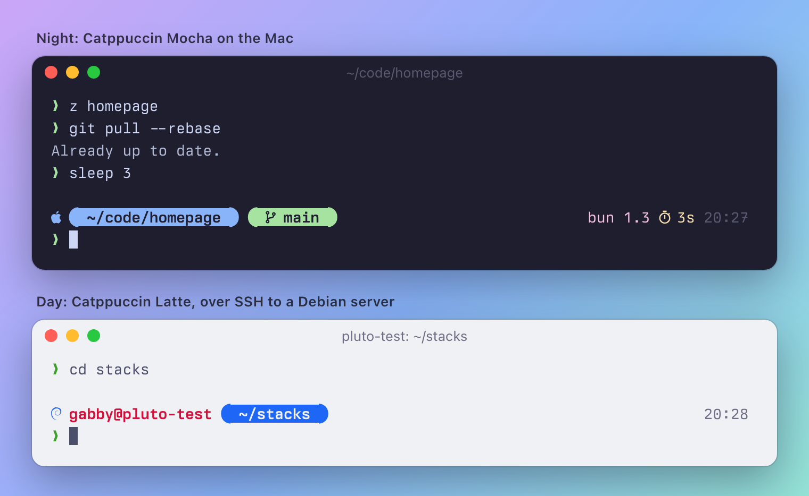

# dotfiles

My terminal, everywhere: **Ghostty**, **zsh** and a **Starship** prompt, a modern
CLI toolbox, and **Catppuccin** colors that follow macOS from Latte by day to Mocha
by night. One command sets up a Mac or a Debian/Ubuntu server; [chezmoi](https://www.chezmoi.io)
keeps every machine in sync.

<p align="center">
  
</p>

> [!TIP]
> Want the story behind these choices? The **[Terminal Setup guide](https://guides.welson.net/Guides/Terminal+Setup/Start+Here)**
> walks through each piece step by step. This repo is the finished result.

## Quick start

On a new machine (macOS, or Debian/Ubuntu):

```sh
curl -fsSL https://raw.githubusercontent.com/gabbywelson/dotfiles/main/install.sh | bash
```

It clones this repo to `~/dotfiles`, installs Homebrew (macOS) or the apt basics
(Linux), asks three questions once (machine profile, git name, git email), installs
the toolbox, applies the config and finishes with a health check. It's safe to run
again at any time.

| Situation | Do this |
| --- | --- |
| Work laptop | `curl … \| DOTFILES_PROFILE=work DOTFILES_EMAIL=you@work.com bash` |
| Already set up, want the latest | `dot update` |
| Machine still on the old layout (before `home/`) | `cd ~/dotfiles && git pull && ./install.sh` |
| Something feels off | `dot doctor` |

After the first run, open **Ghostty**. On a server, log out and back in (zsh becomes
your login shell).

## Everyday use

Everything goes through one command, `dot`:

| Command | What it does |
| --- | --- |
| `dot update` | Pull this repo, install/upgrade packages, apply config, update plugins and themes |
| `dot edit ~/.zshrc` | Edit a managed file *in the repo* and apply it (no argument: open the repo) |
| `dot diff` / `dot apply` | Preview, then apply, config changes |
| `dot doctor` | Check tools, fonts, Ghostty config, login shell, startup time and drift |
| `dot status` | Uncommitted repo changes, plus files that drifted from the repo |
| `dot save` | Copy settings you changed on this machine (say, in T3 Code's settings screen) back into the repo |
| `dot cd` | Jump to the repo |

Changed something in the repo? Commit and push it like any project; other machines
pick it up with `dot update`. Changed a setting inside an app instead? `dot save`
copies it into the repo (and warns if anything that looks like a secret came along),
then commit and push as usual.

## What you get

- **[Ghostty](https://ghostty.org)**: Catppuccin Latte/Mocha switching with macOS
  appearance, Berkeley Mono (falling back to JetBrains Mono Nerd Font), a drop-down
  terminal on <kbd>Ctrl</kbd>+<kbd>`</kbd>, and a notification when a long command
  finishes while you're in another app.
- **A prompt that stays out of the way**: pills for where you are and which branch,
  toolchain versions and timing on the right, `user@host` in red only over SSH. After
  you press Enter it collapses to a bare `❯`, so scrollback reads like a clean list
  of commands.
- **A fast zsh**: ~85 ms to a prompt. Autosuggestions, syntax highlighting, fuzzy
  <kbd>Tab</kbd> completion with previews, <kbd>↑</kbd> that searches by prefix, and
  [atuin](https://atuin.sh) history search on <kbd>Ctrl</kbd>+<kbd>R</kbd>.
- **Modern replacements** for `ls`, `cat`, `find`, `grep`, `du`, `top`, `cd` and
  friends, plus lazygit, yazi, delta and difftastic. The [toolbox](#the-toolbox) has
  the full list.
- **One theme everywhere**. Most tools draw with the terminal's own colors, so when
  Ghostty flips between Latte and Mocha, the prompt, fzf, eza, bat and yazi follow;
  delta and lazygit are told which flavor to use. (The details:
  [docs/how-it-works.md](docs/how-it-works.md#theming).)
- **Agent tooling**: [T3 Code](https://t3.codes)'s settings, favorite models and key
  bindings follow you to every Mac, and [atuin](https://atuin.sh)'s AI turns a `?` at
  an empty prompt into "describe the command you want".
- **Servers that feel like home**: the same shell, prompt and tools on Debian (fresh
  versions straight from upstream via [mise](https://mise.jdx.dev)).

The [cheat sheet](docs/cheatsheet.md) lists every key binding, alias and helper.

## The toolbox

| Tool | Replaces | Try |
| --- | --- | --- |
| [eza](https://eza.rocks) | `ls` | `ll`, `lt` (tree) |
| [bat](https://github.com/sharkdp/bat) | `cat`, `less` | `cat file.py`, `man git` (colored man pages) |
| [fd](https://github.com/sharkdp/fd) | `find` | `fd config` |
| [ripgrep](https://github.com/BurntSushi/ripgrep) | `grep` | `rg TODO`, or `rgf` for a live, previewed search |
| [zoxide](https://github.com/ajeetdsouza/zoxide) | `cd` | `z dotf` jumps to `~/dotfiles`; `zi` picks |
| [fzf](https://github.com/junegunn/fzf) | — | <kbd>Ctrl</kbd>+<kbd>T</kbd> files, <kbd>Alt</kbd>+<kbd>C</kbd> dirs, <kbd>Tab</kbd> everywhere |
| [atuin](https://atuin.sh) | shell history | <kbd>Ctrl</kbd>+<kbd>R</kbd>; <kbd>?</kbd> at an empty prompt asks atuin AI; `atuin login` to sync |
| [delta](https://github.com/dandavison/delta) | `git diff` pager | `git diff`, `git show` |
| [difftastic](https://difftastic.wilfred.me.uk) | line-based diffs | `gdt`: diffs by syntax tree |
| [lazygit](https://github.com/jesseduffield/lazygit) | git porcelain | `lg` |
| [jj](https://jj-vcs.github.io/jj/) | — | `jj git init --colocate` in any repo |
| [yazi](https://yazi-rs.github.io) | Finder in the terminal | `y` (quit with `q` to cd where you ended up) |
| [glow](https://github.com/charmbracelet/glow) | — | `glow README.md` |
| [dust](https://github.com/bootandy/dust) / [duf](https://github.com/muesli/duf) | `du` / `df` | `dust ~/code`, `duf` |
| [btop](https://github.com/aristocratos/btop) | `top` | `btop` |
| [sd](https://github.com/chmln/sd) / [xh](https://github.com/ducaale/xh) | `sed` / `curl` | `sd old new file`, `xh httpbin.org/get` |
| [tealdeer](https://github.com/tealdeer-rs/tealdeer) | `man` | `tldr tar` |
| [mise](https://mise.jdx.dev) / [uv](https://docs.astral.sh/uv/) | nvm, pyenv, pip | `mise use node@22`, `uv run script.py` |
| [direnv](https://direnv.net) | — | per-project env vars from `.envrc` |
| [just](https://just.systems), [watchexec](https://watchexec.github.io), [hyperfine](https://github.com/sharkdp/hyperfine), [fastfetch](https://github.com/fastfetch-cli/fastfetch) | — | `just`, `watchexec -e py pytest`, `hyperfine 'zsh -i -c exit'`, `ff` |

## Machines and profiles

`chezmoi init` asks once per machine and saves the answers in
`~/.config/chezmoi/chezmoi.toml` (re-answer with `chezmoi init --prompt`).

| | Personal Mac | Work Mac | Linux server |
| --- | --- | --- | --- |
| Packages | [Brewfile](packages/Brewfile) | Brewfile, minus personal apps | [apt basics](packages/debian.txt) + [mise toolbox](home/dot_config/mise/conf.d/dotfiles.toml) |
| Git identity | personal | whatever email you enter | asked |
| SSH | 1Password agent, homelab hosts | only `~/.ssh/config.d/*` | GitHub key |
| Apps | Ghostty, T3 Code (with its settings) | Ghostty, T3 Code (with its settings) | — |
| atuin AI | on | off (no work context sent to a third party; flip `[ai]` in the atuin config if allowed) | on |
| Extras | Orrery vault helper | — | Orrery sync timer (if the vault is cloned) |

Some things belong to one machine only. These files are yours: they're never
overwritten, and the managed config loads them last.

| File | For |
| --- | --- |
| `~/.zshrc.local` | shell tweaks, and lines that installers append to `~/.zshrc` |
| `~/.gitconfig.local` | work remotes, credential helpers, signing keys |
| `~/.ssh/config.d/*` | extra SSH hosts |
| `~/.config/ghostty/config.local` | font size for a big monitor, a different font |

## Repository layout

```text
dotfiles/
├── install.sh                 one-line bootstrap (curl | bash)
├── scripts/                   bootstrap-darwin.sh, bootstrap-debian.sh
├── packages/                  Brewfile (macOS), debian.txt (apt)
├── docs/                      cheat sheet, how it works, images
└── home/                      everything chezmoi installs into ~ (.chezmoiroot points here)
    ├── .chezmoi.toml.tmpl     the per-machine questions
    ├── .chezmoiexternal.toml  plugin managers and Catppuccin themes, fetched on apply
    ├── .chezmoiignore         what to skip per OS/profile
    ├── dot_zshrc              → ~/.zshrc: loads ~/.config/zsh/*.zsh
    ├── dot_config/
    │   ├── zsh/               shell modules: options, completion, plugins, tools, prompt, aliases
    │   ├── ghostty/config     terminal
    │   ├── starship.toml      prompt
    │   ├── mise/conf.d/       Linux toolbox
    │   └── …                  atuin, bat, git, jj, lazygit, yazi
    ├── dot_gitconfig.tmpl     → ~/.gitconfig
    ├── dot_t3/userdata/       T3 Code settings, favorites, key bindings (macOS)
    └── dot_local/bin/         dot, dev-doctor, orrery
```

chezmoi's file names encode where files go: `dot_` becomes `.`, `.tmpl` files are
templates, `private_` sets mode 0700. [docs/how-it-works.md](docs/how-it-works.md)
explains the rest, plus how to add a tool, a package or a config file.

## Never in this repo

Credentials, tokens, SSH private keys, shell history, agent sessions and app caches.
The repo is public; anything secret belongs in 1Password or a `*.local` file.

## Rollback

chezmoi asks before overwriting a file that changed since it last wrote it, and
`dot diff` shows exactly what would change. The migration to this layout backed up
the previous versions to `~/archive/dotfiles-backup-2026-10-17` on
the MacBook; older migrations live under `~/archive/dev-env-migration-*` (macOS) and
`~/dotfiles-backup-*` (Linux). Restore a file from there, then open a new shell.
